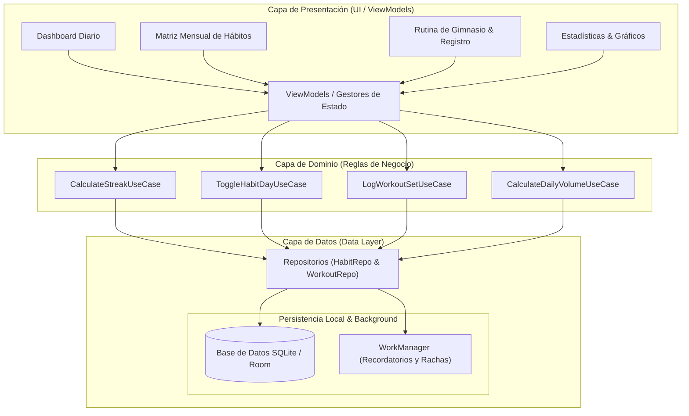

# 🏋️‍♂️ Habit & Gym Tracker App (Android)

Una aplicación móvil moderna para Android diseñada para registrar y monitorear el progreso diario de hábitos saludables y rutinas estructuradas de entrenamiento de fuerza en el gimnasio.

---

## 📌 Tabla de Contenidos
1. [Descripción General](#-descripción-general)
2. [Propósito de Cada Pieza del Sistema](#-propósito-de-cada-pieza-del-sistema)
3. [Diagrama de Arquitectura](#-diagrama-de-arquitectura)
4. [Características Principales](#-características-principales)
5. [Estructura de Datos y Módulos](#-estructura-de-datos-y-módulos)
   - [Módulo de Buenos Hábitos](#1-módulo-de-buenos-hábitos)
   - [Módulo de Rutina de Gimnasio](#2-módulo-de-rutina-de-gimnasio)
6. [Arquitectura y Tecnologías](#-arquitectura-y-tecnologías)
7. [Instalación y Configuración](#-instalación-y-configuración)
8. [Roadmap](#-roadmap)
9. [Licencia](#-licencia)

---

## 📖 Descripción General

La aplicación combina el seguimiento de consistencia mental y física en una sola experiencia fluida:
- **Seguimiento de hábitos diarios:** Inspirado en una matriz mensual continua (estilo *habit tracker* o *bullet journal*) para marcar el cumplimiento día a día.
- **Planificación y registro de entrenamiento:** Basado en un programa semanal de fuerza por grupos musculares (split de hipertrofia/fuerza), permitiendo registrar series, repeticiones y cargas efectivas.

> *"Para aprender y desaprender hábitos mentales y físicos, hay que entrenar el cerebro con paciencia y constancia."*

---

## 🧩 Propósito de Cada Pieza del Sistema

Para garantizar escalabilidad, mantenibilidad y un funcionamiento 100% offline, el sistema se divide en capas modulares con responsabilidades específicas:

### 1. Capa de Presentación (UI & Estado)
- **Dashboard / Vista del Día:** Agrega los hábitos pendientes del día y la rutina asignada para hoy, ofreciendo acceso rápido con un solo toque.
- **Matriz Mensual de Hábitos (*Bullet Grid*):** Renderiza la cuadrícula de 30/31 días para evaluar rachas, consistencia visual y adherencia mensual.
- **Log de Entrenamiento / Workout Tracker:** Interfaz reactiva donde el usuario ingresa peso levantado, repeticiones logradas y marca series completadas en tiempo real.
- **Módulo de Estadísticas:** Procesa y muestra gráficos de volumen semanal (tonelaje = reps × peso) y porcentaje de éxito de hábitos.
- **Gestores de Estado (ViewModels / Controllers):** Conectan la interfaz con la lógica de negocio, gestionando estados como carga, errores y datos en memoria sin depender de la UI.

### 2. Capa de Dominio (Lógica de Negocio Pura)
- **Casos de Uso de Hábitos (`CalculateStreakUseCase`, `ToggleHabitDayUseCase`):** Contienen las reglas algorítmicas de rachas consecutivas, días de descanso y cálculo de adherencia porcentual.
- **Casos de Uso de Entrenamiento (`LogWorkoutSetUseCase`, `CalculateDailyVolumeUseCase`):** Validan repeticiones válidas, registran récords personales (PR) y calculan métricas de sobrecarga progresiva.
- **Modelos de Entidad de Negocio:** Clases inmutables que representan las entidades del sistema sin acoplamiento a librerías de persistencia o interfaz.

### 3. Capa de Datos y Persistencia (Data Layer)
- **Repositorios (`HabitRepository`, `WorkoutRepository`):** Actúan como única fuente de verdad (*Single Source of Truth*), abstrayendo la fuente de datos subyacente.
- **Base de Datos Local (SQLite / Room / Drift):** Almacena el historial completo de entrenamientos y hábitos de manera estructurada y con soporte transaccional.
- **Entidades y DAOs:** Mapean las tablas relacionales (`habits`, `habit_logs`, `routines`, `exercises`, `workout_sets`).
- **Servicio de Tareas en Segundo Plano (WorkManager):** Programa recordatorios locales, verifica cierres de día a medianoche y prepara el cálculo de notificaciones sin gastar batería.

---

## 🏗 Diagrama de Arquitectura

El siguiente diagrama en Mermaid ilustra la interacción entre las diferentes capas del proyecto:



---

## ✨ Características Principales

- **Dashboard Diario Consolidado:** Vista inmediata de las tareas del día sin distracciones.
- **Matriz de Hábitos (1 - 30/31 días):** Vista de cuadrícula mensual para visualizar rachas continuas y hábitos omitidos o descansados.
- **Gestión de Entrenamientos por Día:** Rutinas precargadas con selector de variantes y registro de peso/repeticiones logradas.
- **Métricas de Sobrecarga Progresiva:** Visualización del volumen total levantado por sesión y ejercicio.
- **Estadísticas y Progreso:** Gráficos semanales y mensuales de volumen de entrenamiento y consistencia de hábitos.
- **Modo Offline & Persistencia Local:** Operación 100% independiente de internet con datos guardados de forma segura en el dispositivo.

---

## 🧱 Estructura de Datos y Módulos

### 1. Módulo de Buenos Hábitos

Permite configurar hábitos personalizados y visualizarlos en una cuadrícula mensual de 30 a 31 días:
- **Estados por día:**
  - `Completado` (✔): El hábito fue realizado exitosamente.
  - `No completado` (✘): El hábito no se cumplió.
  - `Descanso / Omitido` (-): Día planificado de descanso o excepción justificada.
- **Métricas calculadas:**
  - **Racha actual (*streak*):** Conteo continuo de días cumplidos.
  - **Tasa de éxito mensual (%):** `(Días completados / Días aplicables) * 100`.
  - **Recordatorios configurables:** Notificaciones locales por hábito en horarios personalizados.

---

### 2. Módulo de Rutina de Gimnasio

El sistema incluye el desglose de ejercicios con sus respectivas series y repeticiones sugeridas:

#### 📅 Lunes: Pectorales & Bíceps
- **Pectorales:**
  - Press de banca plana con barra o mancuerna (4 series × 10-12 reps)
  - Press de banca inclinada con barra o mancuerna (4 series × 10-12 reps)
  - Press de banca declinada con barra o mancuerna (4 series × 10-12 reps)
  - Apertura en Peck-Deck o mancuernas (4 series × 10-12 reps)
- **Bíceps:**
  - Curl con barra recta, barra Z o polea (4 series × 10 reps)
  - Curl en banco Scott o alterno con supinación (4 series × 10 reps)
  - Curl martillo con mancuernas o barra H (4 series × 10 reps)

#### 📅 Martes: Espalda & Tríceps
- **Espalda:**
  - Polea al pecho con agarre ancho (4 series × 10-12 reps)
  - Polea al pecho con agarre inverso cerrado o triángulo (4 series × 10-12 reps)
  - Remo en polea, barra, mancuerna o máquina (4 series × 10-12 reps)
  - Standing cable pushdown (pull-over en polea) (4 series × 10-12 reps)
- **Tríceps:**
  - Press francés en banca plana / rompecráneos (4 series × 10 reps)
  - Copa con mancuerna (4 series × 10 reps)
  - Extensión de tríceps en polea con barra recta, cuerda o barra V (4 series × 10 reps)
  - Fondos en banco (4 series al fallo / máximo)

#### 📅 Miércoles: Piernas (Enfoque Cuádriceps y Pantorrillas)
- Calentamiento: Sentadillas sin peso (3 series × 12 reps)
- Sentadillas con barra (4 series × 10-12 reps)
- Máquina Hack (4 series × 10-12 reps)
- Prensa de piernas con posición de pies baja (4 series × 10-12 reps)
- Extensiones de cuádriceps (4 series × 10-12 reps)
- Sentadilla Sissy o zancadas cortas (4 series × 10-12 reps)
- Pantorrillas (5 series × 25 reps)

#### 📅 Jueves: Hombros & Trapecio
- Press militar / hombros sentado con mancuernas, barra o máquina (4 series × 10-12 reps)
- Elevaciones frontales con barra, mancuernas, disco o polea (4 series × 10-12 reps)
- Elevaciones laterales con polea o mancuerna (4 series × 10-12 reps)
- Pájaro / Hombro posterior en máquina o mancuernas (4 series × 10-12 reps)
- Encogimiento de hombros con barra o mancuernas (4 series × 10-12 reps)

#### 📅 Viernes: Femorales & Glúteos (o Brazo Opcional)
**Opción A: Pierna Posterior & Glúteo**
- Calentamiento: Sentadillas libres sin peso (3 series × 12 reps)
- Sentadilla sumo / piernas separadas (4 series × 10-12 reps)
- Prensa de piernas con posición de pies alta (4 series × 10-12 reps)
- Curl femoral acostado en máquina (4 series × 10-12 reps)
- Peso muerto con barra o mancuerna (4 series × 10-12 reps)
- Zancadas con zancada extendida (4 series × 10-12 reps)
- Patada de glúteo en polea o máquina (4 series × 10-12 reps)
- Hip Thrust / Levantamiento de pelvis (4 series × 10-12 reps)
- Máquina de abductores (4 series × 10-12 reps)

**Opción B (Alternativa): Día de Brazos (Bíceps & Tríceps)**
- Mismo bloque de brazos de lunes y martes combinados para bombeo general.

---

## 🛠 Arquitectura y Tecnologías

| Componente | Tecnología Sugerida |
| :--- | :--- |
| **Plataforma Objetivo** | Android 8.0 (API 26) o superior |
| **UI & Framework** | Jetpack Compose (Kotlin nativo) o Flutter (Dart) |
| **Patrón Arquitectónico** | Clean Architecture + MVVM / BLoC |
| **Persistencia Local** | SQLite vía Room (Kotlin) o Drift / Isar (Flutter) |
| **Inyección de Dependencias** | Hilt / Koin (Kotlin) o Riverpod / GetIt (Flutter) |
| **Trabajo en Segundo Plano** | Android WorkManager para cálculo de rachas y alarmas |
| **Gráficos y Métricas** | Vico / MPAndroidChart (Kotlin) o FL Chart (Flutter) |

---

## 🚀 Instalación y Configuración

### Prerrequisitos
- Android Studio Hedgehog o superior (o Flutter SDK si se compila como multiplataforma).
- JDK 17 o superior.
- Dispositivo Android físico o Emulador configurado con API 26+.

### Pasos de Instalación

1. **Clonar el repositorio:**
   ```bash
   git clone https://github.com/tu-usuario/habit-gym-tracker.git
   cd habit-gym-tracker
   ```

2. **Abrir y sincronizar el proyecto:**
   - Si es Kotlin/Compose: Abrir la carpeta raíz en **Android Studio** y dejar que Gradle sincronice las dependencias (`Sync Project with Gradle Files`).
   - Si es Flutter: Ejecutar `flutter pub get`.

3. **Compilar y ejecutar:**
   - Seleccionar un emulador o dispositivo conectado.
   - Presionar `Run` (`Shift + F10` en Android Studio) o ejecutar:
     ```bash
     ./gradlew installDebug
     ```
     *(o `flutter run` en entorno Flutter).*

---

## 🗺 Roadmap

- [x] **Fase 1: MVP Core**
  - Matriz mensual de hábitos (1-31 días) con estados Completado/No completado/Descanso.
  - Rutinas de gimnasio precargadas (Lunes a Viernes) con series y repeticiones.
  - Base de datos local SQLite y almacenamiento persistente.
- [ ] **Fase 2: Temporizador y Sobrecarga Progresiva**
  - Cronómetro integrado para descansos entre series (ej. 60s, 90s, 120s).
  - Histórico de pesos anteriores sugeridos en cada ejercicio.
- [ ] **Fase 3: Métricas Avanzadas y Respaldo**
  - Gráficos de tonelaje mensual y porcentaje de adherencia global.
  - Exportación de datos en formato CSV / JSON y copia de seguridad local.
- [ ] **Fase 4: Integración con Salud y Wearables**
  - Conexión con Health Connect / Google Fit.
  - App complementaria para Wear OS para registrar series desde el reloj.

---

## 📄 Licencia

Este proyecto se distribuye bajo la licencia **MIT**. Consulta el archivo `LICENSE` para más detalles.
